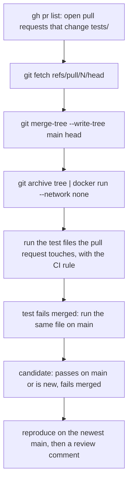

# Testing open pull requests merged with `main`

How I reviewed pull requests in a very busy open-source repository: each pull request merged with the newest `main`,
its tests run in a container with no network, a review comment only for a defect I reproduced.

Python, Docker, git (`merge-tree`, `archive`), GitHub CLI

[pr-sandbox](https://github.com/maciejszulia/pr-sandbox) | [Controlled English](https://github.com/maciejszulia/controlled-english) | [Project index](../README.md)

## Context

[ItsNotRexed/Leonida](https://github.com/ItsNotRexed/Leonida) is an open-source native-recompilation project where
contributors and their coding agents work at the same time; the pull request template asks whether a pull request is
AI-assisted. On 2026-11-23 at 21:12 CET it had 4,188 open pull requests from 799
authors. Its coordination issue #8868 received 200 comments in 15 minutes (19:41 to 19:56 UTC).

At that rate a green check on a pull request ages fast: CI tested the merge with `main` at push time, and 60 pull
requests reached `main` in the hour before 18:54 UTC.

## The defect class

Pull request #4734 passes its own tests on its head and fails them after the merge (measured 2026-11-23, 20:01 UTC):

| Tree | `tests/test_find_hash_lookup.py` |
| --- | --- |
| `main` at `867d922f` | 5 tests OK |
| `main` at `867d922f` merged with head `40ac5f60` | 6 tests, 3 failures |
| head `40ac5f60` alone | 5 tests OK |

## Method

- `git merge-tree --write-tree` builds the merged tree without a working tree, so 3 workers share 1 clone.
- The container gets the tree as a tar stream: no network, no Linux capabilities, a non-root user, memory and process limits.
  The laptop that runs it holds other data, and the pull requests come from authors I do not know.
- A candidate is not a finding. I post only after I reproduce the failure on the newest `main` and find the cause.
- `merge-bisect` finds the commit on `main` after which a merged test fails, and `train.py` merges many pull requests
  locally, tests them once and drops the one that breaks a test. Graphs of both runs and of the merges on `main` that
  break open pull requests: [pr-sandbox, Graphs](https://github.com/maciejszulia/pr-sandbox#graphs).

## Results

First sweep, `main` at `dde82f27`, 2026-11-23, 86 minutes on a ThinkPad T470p:

| What | Count |
| --- | --- |
| pull requests checked | 1,667 |
| merge conflict with `main` | 304 |
| test files that fail only after the merge (candidates) | 37 in 36 pull requests |
| candidates triaged: real defects / false positives | 4 / 1 |

Other reviewers had already reported 3 of the 4 real defects. The false positive came from my tool (the container had
no git repository) and is fixed in pr-sandbox.

## What I contributed

| Kind | Items |
| --- | --- |
| pull requests | [#8122](https://github.com/ItsNotRexed/Leonida/pull/8122) (negative tests that accepted every exception), [#8165](https://github.com/ItsNotRexed/Leonida/pull/8165) (a documented count corrected to 52 of 52) |
| review comments with steps to reproduce | 9 pull requests; the author of 2 of them changed the code after the review |
| tool proposal to the maintainers | [#9038](https://github.com/ItsNotRexed/Leonida/issues/9038) |

## What I would tell a team that works like this

1. Test the merge, not only the head. A report says which tree it tested: "Tested `<head>` merged with `main` at `<sha>`".
2. Name the commit in every sentence about code. Here `main` took 60 merges in 1 hour.
3. Run code from unknown authors in a container with no network, even when you only run its tests.
4. Keep claims and findings to 1 line in a fixed form. A thread with 200 comments in 15 minutes is read by search.
5. Measure again right before you post. A number from 1 hour ago describes another `main`.

The rules for points 1, 2 and 4 are module S of [Controlled English](https://github.com/maciejszulia/controlled-english).
