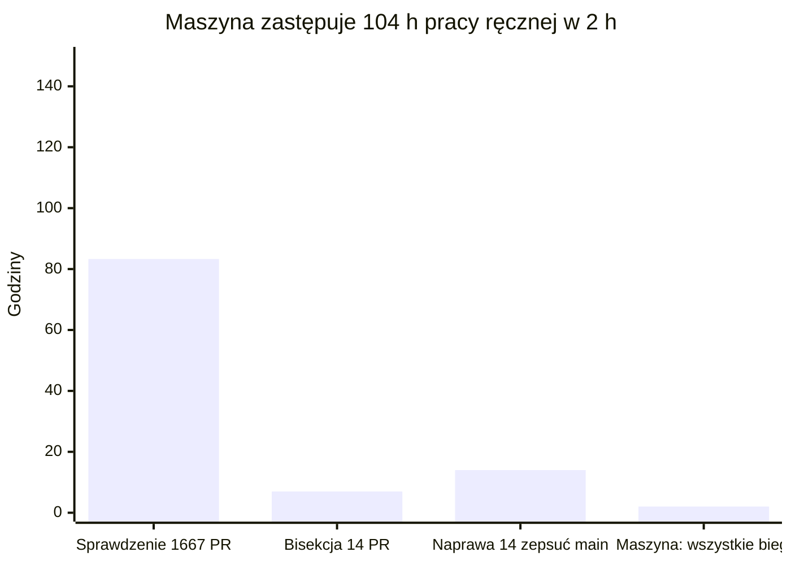

# Ile czasu, energii i pieniędzy oszczędza pullrequest-sandbox

Case study z 1 wieczoru: 2026-11-23, repozytorium [ItsNotRexed/Leonida](https://github.com/ItsNotRexed/Leonida),
narzędzie [pullrequest-sandbox](https://github.com/maciejszulia/pullrequest-sandbox). Opis techniczny po angielsku:
[Testing open pull requests merged with `main`](leonida-merge-sweep.md).

> Legenda: `[pomiar]` oznacza wartość zmierzoną, `[obliczenie]` wartość policzoną z podanych danych, `[założenie]`
> wartość przyjętą bez pomiaru. „Lub” znaczy co najmniej 1 z członów. Zakres „od A do B” obejmuje obie granice.

## Wynik w 1 tabeli

| Co | Wariant środkowy | Zakres | Źródło |
| --- | --- | --- | --- |
| Praca ręczna, którą narzędzie zastępuje | 104 h | od 66 h do 181 h | `[obliczenie: tabela „Model”]` |
| Praca maszyny bez udziału człowieka | 2,04 h | - | `[pomiar: znaczniki czasu plików wyników]` |
| Wartość pracy przy stawce 50 zł/h | 5 218 zł | od 3 303 zł do 9 046 zł | `[obliczenie]`, stawka ze wzoru kosztorysu autora |
| Energia: maszyna | co najwyżej 0,12 kWh | - | `[obliczenie: 2,04 h × 60 W]` |
| Energia: człowiek przy komputerze przez 104 h | 10,4 kWh | od 6,6 kWh do 18,1 kWh | `[obliczenie: 100 W, założenie]` |

## Sytuacja przed narzędziem

1. Repozytorium miało 4425 otwartych pull requestów `[pomiar: API GitHuba, 2026-11-23, 21:58 CET]`.
2. Do `main` trafiło 60 pull requestów w 1 h przed 18:54 UTC `[pomiar: git log --first-parent]`.
3. CI nie dawało wyniku. Spośród 200 biegów CI z okna od 20:52 UTC do 21:03 UTC 134 biegi czekały na zgodę
   maintainera (`action_required`), a tylko 2 biegi skończyły się wynikiem `[pomiar: gh run list]`. Spośród 100
   biegów na `main` 65 zostało anulowanych, a 29 czekało na zgodę; żaden bieg nie dał wyniku pass ani fail
   `[pomiar: gh run list --branch main]`.
4. Skutek: przy commicie `3ae06542` na `main` padało 16 z 438 plików testów biblioteki standardowej
   `[pomiar: pullrequest-sandbox, 2026-11-23, 18:24 CET]`. Każdy z 16 plików miał osobny pull request z poprawką.

## Co zrobiło narzędzie

| Bieg | Wynik | Czas maszyny | Źródło |
| --- | --- | --- | --- |
| `sweep.py`: każdy otwarty PR scalony z `main` i przetestowany | 1667 PR, 37 podejrzanych plików testów | 86 min | `[pomiar: 18:57 – 20:23 CET]` |
| `merge-check`: ponowny test 32 podejrzanych plików | 15 plików pada tylko po scaleniu | 9 min | `[pomiar: 21:11 – 21:20 CET]` |
| `merge-bisect`: commit na `main`, który psuje każdy z 15 PR | 14 dokładnych wyników | 24 min | `[pomiar: 21:23 – 21:47 CET]` |
| `merge-check` na nowym `main` przed publikacją | 15 z 15 potwierdzonych | 2 min | `[pomiar: 21:53 – 21:55 CET]` |
| `train.py`: pociąg 5 PR | 1 PR odrzucony, 4 scalone w 1 tipie | 1,6 min | `[pomiar: 21:42:26 – 21:44:00 CET]` |

14 pull requestów od 7 autorów dostało komentarz review z krokami do odtworzenia i z commitem, do którego autor MUSI
dostosować pull request `[pomiar: gh pr view]`. Maintainerzy dostali tabelę w [issue #9038](https://github.com/ItsNotRexed/Leonida/issues/9038).

## Model oszczędności

| Składnik | Liczba | Czas ręczny na 1 sztukę | Godziny: środek, od, do |
| --- | --- | --- | --- |
| A. Sprawdzenie PR: pobranie, scalenie z `main`, uruchomienie testu | 1667 PR `[pomiar]` | 3 min, od 2 min do 5 min `[założenie]` | 83,3; 55,6; 138,9 |
| B. Bisekcja ręczna: commit na `main`, który psuje test PR | 14 PR `[pomiar]` | 30 min, od 15 min do 60 min `[założenie]` | 7,0; 3,5; 14,0 |
| C. Naprawa `main` po scaleniu PR, który psuje test | 14 zepsuć `[pomiar]` | 1 h, od 0,5 h do 2 h `[założenie]` | 14; 7; 28 |
| Razem | | | 104,3; 66,1; 180,9 `[obliczenie]` |

Wartość w złotych `[obliczenie: godziny × stawka]`:

| Stawka za 1 h | Środek | Od | Do |
| --- | --- | --- | --- |
| 50 zł (stawka autora) | 5 218 zł | 3 303 zł | 9 046 zł |
| 100 zł | 10 435 zł | 6 607 zł | 18 092 zł |
| 150 zł | 15 652 zł | 9 910 zł | 27 138 zł |

Koszt narzędzia: sesja agenta zbudowała pierwszą wersję w czasie od 17:56 CET do 19:19 CET, a `merge-bisect` i
`train.py` w czasie od 21:20 CET do 21:48 CET `[pomiar: znaczniki plików i commitów]`. Razem co najwyżej 1,9 h sesji,
czyli co najwyżej 95 zł przy stawce 50 zł/h `[obliczenie]`; sesja robiła w tym czasie także review. Prąd dla maszyny kosztuje mniej niż 1 zł `[obliczenie: 0,12 kWh]`.

## Energia

- Procesor i7-7700HQ ma TDP 45 W `[źródło: specyfikacja Intel]`. Cały laptop pod obciążeniem pobiera 60 W
  `[założenie]`. 2,04 h × 60 W = 0,12 kWh `[obliczenie]`.
- Człowiek przy komputerze z monitorem zużywa 100 W `[założenie]`. 104 h × 100 W = 10,4 kWh `[obliczenie]`.
- Maszyna zużywa 85 razy mniej energii niż człowiek przy tej samej pracy `[obliczenie: 10,43 kWh ÷ 0,122 kWh]`.

## Kto zyskuje, a kto jeszcze nie

| Kto | Zysk | Stan 2026-11-23, 22:05 CET |
| --- | --- | --- |
| Recenzent (autor narzędzia) | składnik A: 1667 sprawdzeń bez pracy ręcznej | zrealizowany |
| 7 autorów 14 PR | składnik B: gotowy commit do dostosowania zamiast ręcznej bisekcji | komentarze wysłane, odpowiedzi brak |
| Maintainerzy | składnik C: 14 zepsuć `main` mniej przy masowym scalaniu | warunkowy: zależy od użycia tabeli z #9038 albo `train.py` |

## Granice

- Składnik A to koszt alternatywny: bez narzędzia nikt nie sprawdziłby ręcznie 1667 PR. Wartość pewna to składniki
  B i C, czyli 21 h, od 10,5 h do 42 h `[obliczenie]`, przy 50 zł/h: 1050 zł, od 525 zł do 2100 zł.
- Czasy ręczne i moc sprzętu to założenia. Licznik energii RAPL wymaga uprawnień roota, więc energii maszyny nie
  zmierzono.
- Liczby dotyczą 1 repozytorium i 1 wieczoru. Inne repozytorium MUSI zmierzyć własne liczby PR, scaleń i biegów CI.
